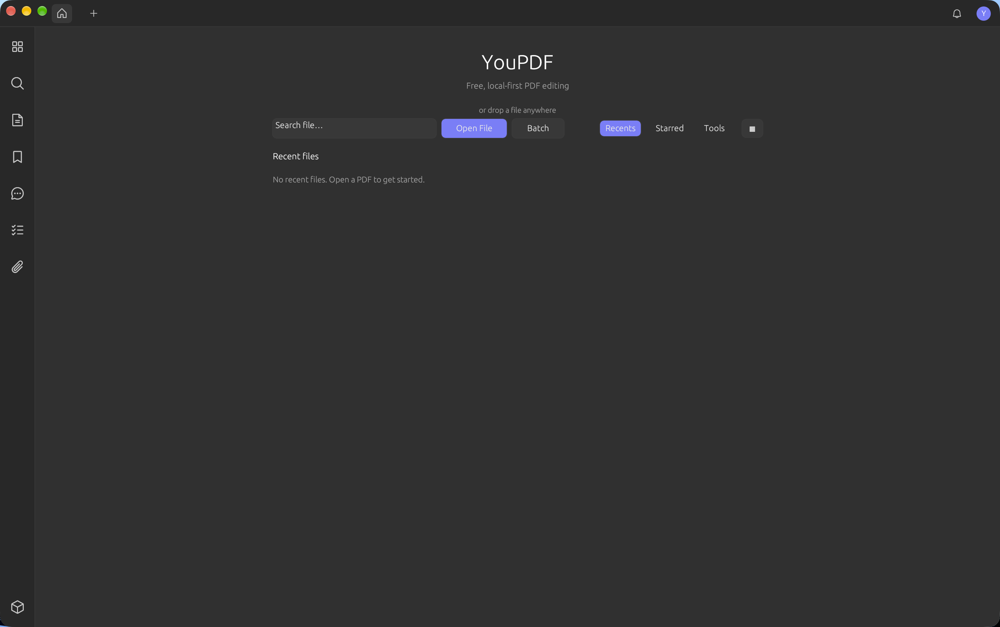
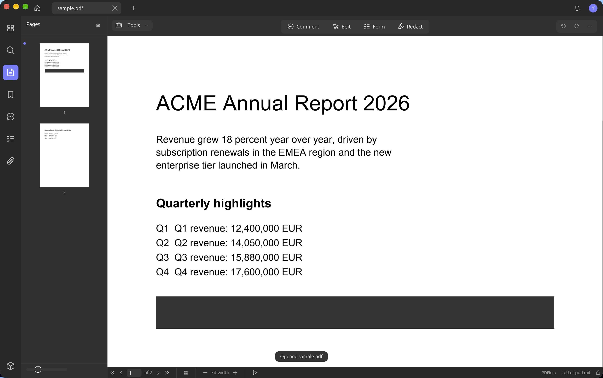
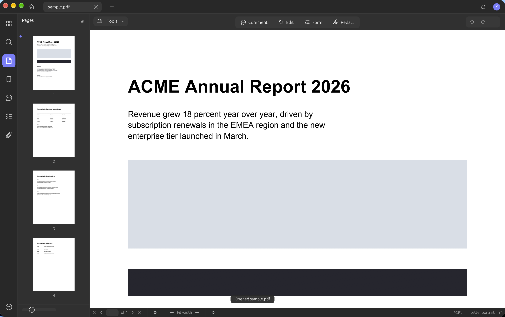

# YouPDF

YouPDF is a local-first PDF editor for the desktop, written in Rust: the user
interface, the PDF engine and the AI layer are Rust crates, and the only
foreign component is the rasteriser, PDFium (the renderer behind Chrome's PDF
viewer). It is built for people who read, review and archive PDFs every day and
want an app that never sends their documents anywhere. No account, no upload,
no watermark, no telemetry, no artificial page limit — the app works fully
offline and only touches the network if you switch the optional AI assistant
on.



## Screenshots

| | |
|---|---|
|  |  |
| **Home** — recent files, starred files and the tool shortcuts on one screen. | **Viewer** — a document open with the page sidebar, the canvas and the inspector. |
|  | |
| **Editor** — a multi-page document rendered through PDFium, thumbnails panel open. | |

## Features

### View and navigate

- Tabs, a home screen with **Recents**, **Starred** and **Tools** sections, and
  a file grid or list. Starred files are remembered in `~/.youpdf/starred.txt`.
- Thumbnails panel, continuous scrolling, zoom (fit width, fit page, actual
  size), and four page layouts: single, continuous, two pages, and cover.
- Fullscreen mode, slideshow mode (<kbd>F5</kbd>), and printing through the
  system `lp` command.
- Side rail with page thumbnails, full-text search, bookmarks, comments, form
  fields and attachments.
- **Search and replace** over a built text index, with case folding.
- **Text selection** at character level using PDFium glyph boxes; double-click
  selects a word, triple-click selects a line.
- **Measure tool**: distance, perimeter and area, with a scale you can
  calibrate against a known distance (72 points per inch reads inches at 1:1).

### Edit content

- Four working modes — **Comment**, **Edit**, **Form**, **Redact** — each with
  its own tool strip.
- Edit mode covers in-place text editing (font family, size, colour, bold,
  italic, underline, strike-out, alignment and line spacing), image
  placement (replace, rotate, flip, crop, opacity) and hyperlink insertion.
- **Annotations**: highlight, underline, strike-out, squiggly, note, free text,
  square, circle, line, arrow, ink, stamp, link and callout, with colours and
  opacity.
- **Comments** panel with filters, threaded replies, review states, and export
  to FDF, XFDF, CSV or Markdown.
- **Forms**: fill existing AcroForm fields (including inherited fields with
  widget-level entries), and build new text fields, checkboxes, radio buttons,
  dropdowns, list boxes, buttons, date fields, barcodes and signature fields.
  Form data can be read back and exported.
- **Bookmarks** can be read, generated from the text layer and cleared;
  **attachments** can be listed, extracted, added and removed.
- Undo and redo on every mutation.

### Organise pages

- Rotate, delete, move, duplicate, insert blank pages, insert pages from
  another file, and replace or extract page ranges.
- **Crop** with explicit margins in pt, mm, cm or in, a choice of the page box
  to write (CropBox, ArtBox, BleedBox, TrimBox), auto-crop of the margins, or
  reset of the crop box.
- **Split into tiles** (rows × columns) with an adjustable gap between tiles;
  split a document into several files by page count, file size or bookmarks.
- **Watermark** (text, anchored, tiled, with a layer choice), **header and
  footer** with macros, **page numbers** with a choice of number styles, and a
  page **background** (colour, opacity or image, with scaling and page range).
- **Bates numbering** with prefix, suffix, start value, step, digit count, font
  size, margin and position.

### Produce and protect

- **Redaction** in two phases: mark the areas, choose their appearance (fill
  colour, overlay text), then confirm. The engine rewrites the content stream
  instead of rasterising the page, so the text outside the marked areas stays
  selectable — only a page whose content cannot be sliced cleanly falls back
  to rasterisation, and the report says so. An optional sanitising pass over
  the document follows.
- **Compression**: several presets, recompression of the content streams,
  pruning of unused objects, a size estimate before saving, and a report of
  what was saved.
- **Protection**: RC4-128 (revision 3) and AES-256 (revision 6) encryption with
  an open password and a permissions password, per-permission flags (print,
  copy, modify, annotate), removal of protection, and opening a protected file
  with its password.
- **Declared PDF/A and PDF/X markers**: PDF/A-1b, PDF/A-2b, PDF/X-1a, PDF/X-4
  and PDF/E-1. The engine writes the XMP packet, `/OutputIntents`, `/MarkInfo`
  and `/ID` the standards ask for, but it does not validate the result — fonts,
  transparency and structure are not checked and no ICC profile is embedded,
  so a validator (veraPDF, preflight) is still needed to call the file
  conforming.
- **OCR** through the system Tesseract binary, in three modes (editable text,
  text plus image, or a searchable PDF), with automatic detection of scanned
  pages, a catalogue of 48 languages, multi-language combinations
  (`eng+fra`), and the list of languages actually installed read from
  `tesseract --list-langs`.
- **Compare** two documents and browse the differences: added, removed and
  modified lines, plus pages that were added or removed.
- **Extract data**: tables and key/value pairs out of the text layer.
- **Digital signatures at library level**: detached PKCS#7 / PAdES RSA-SHA-256
  signatures, self-signed certificate creation, PKCS#12 import, visual
  signature placement and signature validation.
- **Batch window**: apply export, OCR, compression, protection, flattening,
  watermarks, headers/footers, Bates numbering, backgrounds, page insertion and
  page removal to a whole folder, combine several files into one PDF, or send
  everything to the printer — on a worker thread, not on the UI thread.


### Export

| Target | Formats |
|---|---|
| Text | Plain, Markdown, HTML, CSV, XML, RTF |
| Images | PNG, JPEG, TIFF (one file per page), plus one long image with all pages stacked; 36–600 dpi |
| Embedded images | PNG, one file per image embedded in the document |
| Office | Word `.docx`, Excel `.xlsx`, PowerPoint `.pptx` — reflowed text, or exact layout for Word (each run positioned), with Excel column detection and one slide per page |
| Standards | PDF/A-1b, PDF/A-2b, PDF/X-1a, PDF/X-4, PDF/E-1 — declared markers, not validated conformance |

Text export rebuilds the text layer only: images, tables and the page layout are
left out. The Office exporters rebuild the text as paragraphs, rows or slides
and carry the page images over; the original geometry is kept only by the
exact-layout option (Word).

### AI assistant (optional)

The assistant is **off by default**. When you switch it on in Preferences, it can
talk to your own provider and work on the text of the open document:

- Providers: OpenAI, any OpenAI-compatible endpoint, Anthropic, Gemini and
  Ollama (local models, so this part stays offline).
- Tasks: chat, summarise, translate, key points, explain, legal review and
  financial review.
- API keys are stored in the **OS keyring** (Keychain on macOS), never in the
  settings file.
- Requests run on a worker thread, so the window stays responsive.


### Interface

- **English and French** interface, switchable at any time from Preferences.
- Four themes: Dark, Light, Mint and Starry.
- **Preferences**: startup view, default zoom, default layout, author name,
  measure unit, auto-save interval, appearance and the AI switch. Edits are
  kept as a draft until you press Save.
- Auto-save for dirty, unprotected tabs at the interval you choose.
- Document properties panel (title, author, subject, keywords, producer, size,
  page count).

## Install

The crates are not published on crates.io, so install the application from a
checkout of this repository:

```sh
cd youpdf
cargo install --path crates/youpdf-app
```

This installs the `youpdf` binary. It needs the **PDFium** runtime library at
run time (see below) and, for OCR, the **Tesseract** binary.

On macOS you can also build a native application bundle with a real `.icns`
icon:

```sh
cargo build --release -p youpdf-app
scripts/build-macos-app.sh      # -> target/YouPDF.app
```

## Build from source

### Toolchain

The workspace is Rust 2021 edition and needs **Rust 1.78 or newer**. The pinned
toolchain is stable, with `rustfmt` and `clippy`:

```sh
rustup show                     # channel: stable, components: rustfmt, clippy
cargo fmt --all -- --check
cargo clippy --workspace --all-targets
```

### PDFium

PDFium is the rasteriser used to draw pages; it is a shared library, not a Rust
crate. A macOS build of `libpdfium.dylib` is vendored in `pdfium/`, and the
script below downloads the right build for your platform:

```sh
scripts/install-pdfium.sh                  # default: chromium/6729
scripts/install-pdfium.sh chromium/6729
```

The library is searched in this order: `$YOUPDF_PDFIUM_DIR`, `$PDFIUM_DIR`,
`./pdfium/`, the directory next to the executable (walking up), the current
working directory, then the usual system paths.

On macOS a freshly downloaded library carries the quarantine attribute and
`dyld` refuses to load it. The script removes the attribute and signs the file
ad-hoc; if you fetched it by hand:

```sh
xattr -d com.apple.quarantine pdfium/libpdfium.dylib
codesign --force --sign - pdfium/libpdfium.dylib
```

Without PDFium the application still starts: it logs `pdfium indisponible : <err>`
and paints the pages with a flat near-white placeholder. The operations that
need a real rasteriser then refuse to run instead of producing empty pages —
redaction (when a page has to be rasterised), the searchable PDF and the
image-PDF export.

### Tesseract (optional)

OCR shells out to the system `tesseract` binary, so install it from your package
manager (`brew install tesseract`, `apt install tesseract-ocr`). The language
list is read from `tesseract --list-langs` when the OCR window opens, and
combinations such as `eng+fra` are accepted.

### Run

```sh
cargo run -p youpdf-app                          # debug
cargo build --release -p youpdf-app              # release binary
./target/release/youpdf path/to/document.pdf      # open a file at launch
```

### macOS app bundle (native icon)

```sh
cargo build --release -p youpdf-app
scripts/build-macos-app.sh      # target/YouPDF.app avec YouPDF.icns
```

The bundle embeds the native `.icns` icon (declared via `CFBundleIconFile`).
For plain `cargo run` builds eframe sets the dock icon from
`crates/youpdf-app/src/assets/icon.png` instead.

Regenerate the icon from `docs/youPDF-icon.svg` with:

```sh
scripts/build-macos-icon.sh
```

It insets the artwork by 6.25 % (Apple's margin) — without that inset the
icon reads oversized in the Dock.

## Usage

1. Launch `youpdf`. The home screen lists your recent files; **Tools** opens
   the tool shortcuts, and the star on a card adds the file to **Starred**.
2. Open a PDF — by double-clicking a card, dropping a file on the window, or
   <kbd>⌘O</kbd>. The page sidebar, the canvas and the inspector open.
3. Pick a mode in the toolbar: **Comment** to annotate and discuss, **Edit** to
   change text and images, **Form** to fill or build a form, **Redact** to
   black out content for good.
4. Save with <kbd>⌘S</kbd>, or **Save As…** for a copy. <kbd>⌘P</kbd> sends the
   document to the system printer.

Shortcuts: <kbd>⌘O</kbd> open, <kbd>⌘W</kbd> close, <kbd>⌘S</kbd> save,
<kbd>⇧⌘S</kbd> save as, <kbd>⌘P</kbd> print, <kbd>⌘D</kbd> properties,
<kbd>⌘Z</kbd> / <kbd>⇧⌘Z</kbd> undo and redo,
<kbd>⌘C</kbd> / <kbd>⌘A</kbd> copy and select all, <kbd>⌘,</kbd> preferences,
<kbd>⌘F</kbd> focus the search field, <kbd>⌘G</kbd> / <kbd>⇧⌘G</kbd> next and
previous search result, <kbd>⇧⌘F</kbd> fullscreen, <kbd>F5</kbd> slideshow,
<kbd>⌘+</kbd> / <kbd>⌘−</kbd> / <kbd>⌘0</kbd> zoom, and <kbd>⌃1</kbd> …
<kbd>⌃0</kbd> for the modes and the tools of the Tools menu.

## Architecture

| Crate | Role |
|---|---|
| `youpdf-shared` | Shared vocabulary: the `Error`/`Result` pair, the translation table (`i18n`, English and French) and the theme tokens (`Theme`, `Palette`). |
| `youpdf-core` | The PDF engine. Parsing and writing with `lopdf`, rasterisation with `pdfium-render`, annotations, forms, redaction, encryption, OCR glue, text and Office export, comparison, extraction, measurements, page organisation. |
| `youpdf-ai` | The optional AI layer: one `AiProvider` trait, implementations for OpenAI-compatible endpoints, Anthropic and Ollama, keyring storage for the API keys, and the JSON settings file. |
| `youpdf-app` | The desktop application (`eframe`/`egui`): canvas compositor, panels, inspectors, modals, home screen, menu bar. Produces the `youpdf` binary. |

Data flow: a file is opened into a `youpdf_core::Document`; the app asks the
renderer for page bitmaps and paints them on the egui canvas; every edit is a
call into `youpdf-core` that mutates the document in place, and saving writes
the bytes back. The AI panel is the only part that talks to the network, and it
runs on its own worker thread with its own runtime.

## Layout

```
crates/
  youpdf-shared/   types, errors, theme tokens
  youpdf-core/     PDF engine: parsing, render (PDFium), annotate, forms,
                   redact, protect (RC4/AES-256), edit, OCR, convert, search
  youpdf-ai/       multi-provider AI layer (OpenAI-compatible, Anthropic,
                   Ollama; API keys in the OS keychain)
  youpdf-app/      desktop app (eframe/egui)
pdfium/            vendored libpdfium.dylib
scripts/           helper scripts
docs/              design notes, parity plan, screenshots
```

## Testing

```sh
cargo test --workspace
```

The suite is mostly integration tests over generated PDFs, so it needs no
fixtures on disk. `youpdf-core` alone carries 231 integration tests spread
across 31 files, covering redaction, encryption, forms, annotations, crop,
watermark, compression, OCR modes, comparison, extraction, measurement, page
organisation, PDF/A markers, text export and Office export. The
application crate adds unit tests next to the code: the inspector placement
and colour parsing, the home screen filter, star and relative time, and the
internals of the document tab (undo history, form snapping, tab moves,
bookmarks, page layouts, selection and reading order, comment threads and
filters, crop fractions, the startup view preference, word and line
expansion).

## Roadmap

### Shipped

Tabs, home screen with recents and favourites, thumbnails, search and replace,
zoom, continuous scroll, page layouts, slideshow, text selection and copy,
in-place text and image editing, annotations (markup, ink, shapes, stamps,
signatures), bookmarks and attachments sidebars, a comment list with filters,
threads, review states and FDF/XFDF/CSV/Markdown export, canvas themes and page
tints, forms (fill and build), page organizing, crop with box targets and
auto-crop, tile splitting, watermark with anchoring/tiling/layering,
header/footer macros, Bates numbering, compression presets with pruning and
size estimate, protection (RC4/AES-256, permissions, remove-protection),
redaction and sanitizing, OCR (searchable, text+image, editable) with
scanned-page detection, measurement with calibration, document comparison with
a difference navigator, batch processing (convert, OCR, insert, remove,
watermark, background, header/footer, Bates, compress, protect, flatten,
combine, print), Office export (Word/Excel/PowerPoint, flow and exact layout,
Excel column detection, Word image embedding), preferences with auto-save,
English/French UI (menus, tools, common buttons, preferences, inspector
controls), and the AI assistant.

### Closed parity gaps

1:1 UPDF parity per `docs/UPDF_IMPLEMENTATION_PLAN.md`:

- Character-level text selection via pdfium glyph boxes
- Inherited form fields with widget-level entries
- Overflow menu with capped height and nested submenus
- Full PKCS#7 / PAdES detached RSA‑SHA‑256 digital signatures
- French translation for the menus, the tools, the common buttons, the
  preferences and the inspector controls

### Next

In progress: 1:1 UPDF parity per `docs/UPDF_IMPLEMENTATION_PLAN.md`. The six
gaps previously listed as known are now closed: the redaction engine rewrites
the content stream instead of rasterising the page, double‑click selects a
word and triple‑click a line, the OCR dialog offers a language catalogue
with multi‑language combinations, the Office exporters rebuild Word, Excel and
PowerPoint layouts, the preferences keep the startup view, and the page
operations cover crop units, tile gaps and the Bates step.

## Contributing

Issues and pull requests are welcome. The project is a Cargo workspace with four
crates: keep the PDF logic in `youpdf-core`, the interface in `youpdf-app`, the
shared vocabulary in `youpdf-shared` and the network calls in `youpdf-ai`, and
do not let the core crate depend on the UI crate.

Before opening a pull request:

```sh
cargo fmt --all
cargo clippy --workspace --all-targets
cargo test --workspace
```

New behaviour needs a test: `youpdf-core` uses integration tests under
`crates/youpdf-core/tests/` that build small PDFs in memory, and the
application crate uses unit tests next to the code. UI strings are translated in
`crates/youpdf-shared/src/i18n.rs` — add the English and the French wording
together.

## License

MIT — see `LICENSE`.
